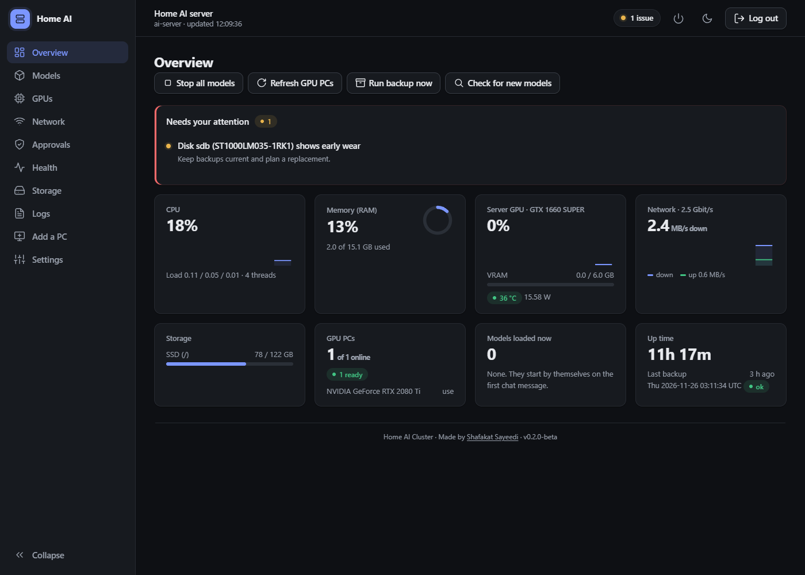
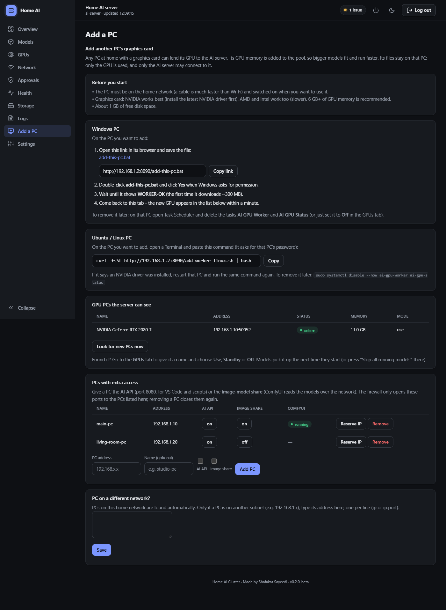
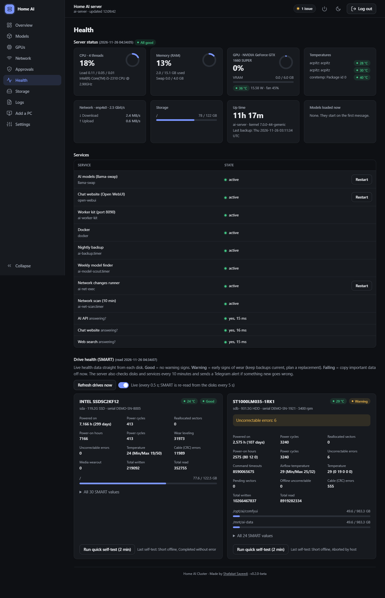
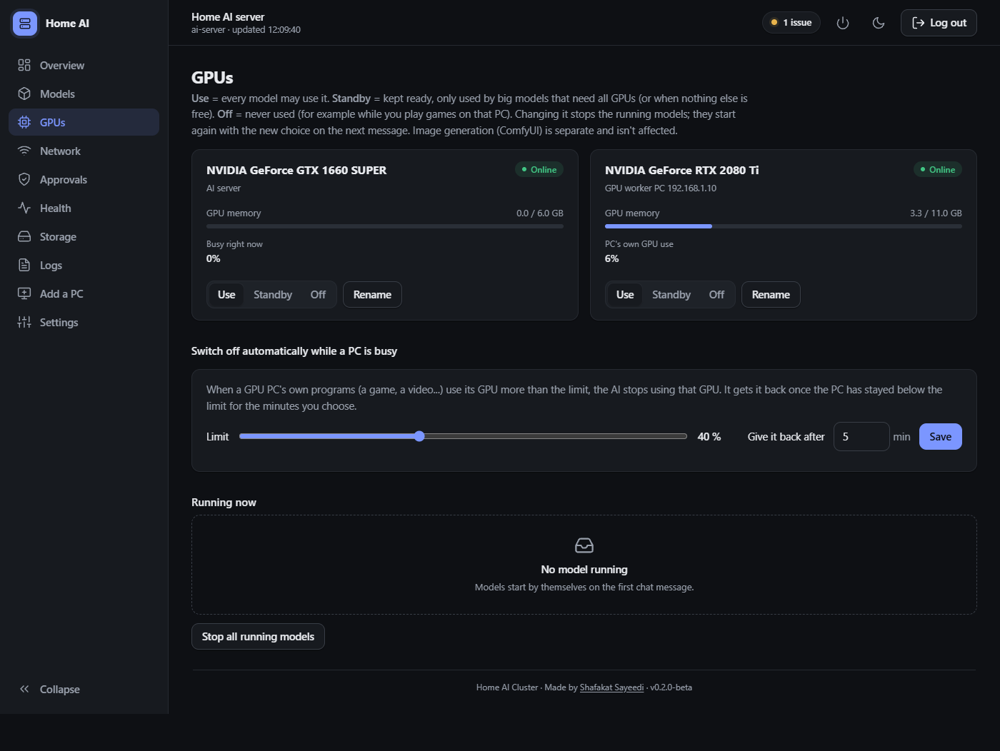
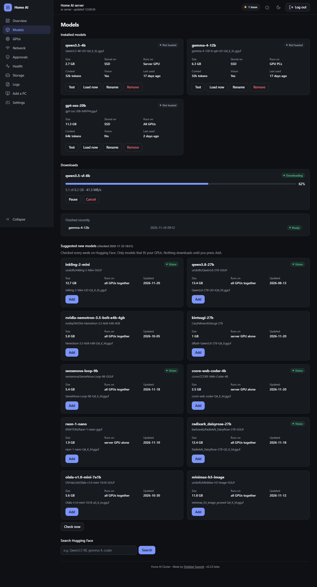
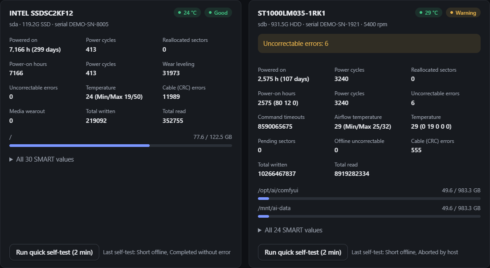
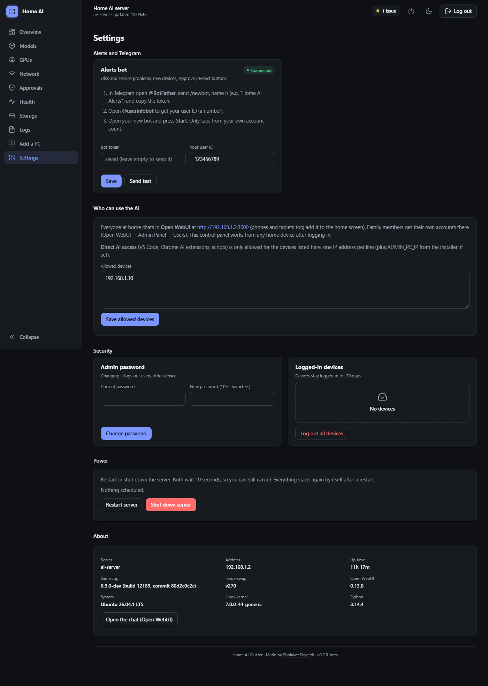
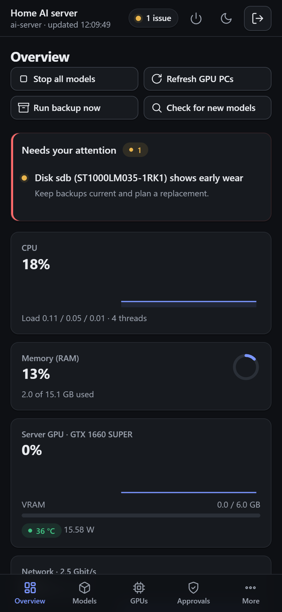
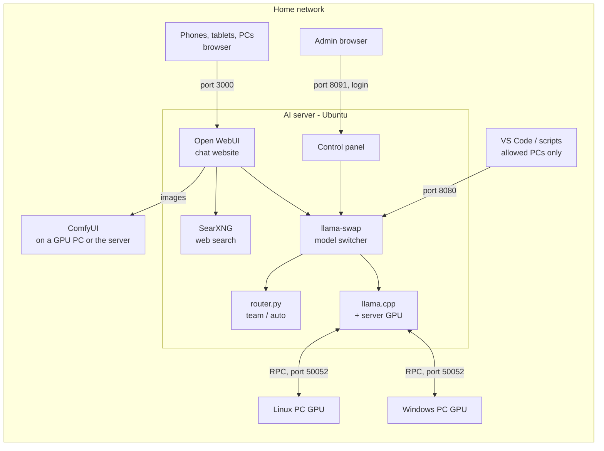

# Home AI Cluster

Run your own private AI at home: a chat website for the whole family, an OpenAI-compatible API, optional image generation, and a control panel to manage it all. Everything runs on your own hardware, with no cloud and no subscription, and the chats stay at home.

It started as my own setup: a small Ubuntu server with a 6 GB GTX 1660 Super and a gaming PC with an 11 GB RTX 2080 Ti. Neither card can run a 20B model on its own, but together they can. So this project splits one model across the GPUs of several PCs over the home network (llama.cpp RPC) and puts a normal chat website in front of it.

> **Status: beta (v0.2.0-beta).** It runs every day on my own server. A clean install on a fresh machine, AMD/Intel GPUs, RAID creation on real drives and ComfyUI on the server haven't been tested yet. If something breaks on your hardware, please [open an issue](https://github.com/shafakat12/home-ai-cluster/issues).

**Contents:** [Features](#what-it-does) · [Requirements](#requirements) · [Step-by-step setup](#step-by-step-setup) · [Image generation (ComfyUI)](#part-3--image-generation-with-comfyui-optional) · [Telegram](#part-4--telegram-alerts-optional) · [Using it](#using-it) · [Control panel tabs](#the-control-panel-tab-by-tab) · [Docs](#documentation) · [Settings](#settings-configenv) · [Updating](#updating-and-removing)

## What it does

- **Family chat:** [Open WebUI](https://github.com/open-webui/open-webui) on port 3000, one account per person, works on phones.
- **GPU pooling:** big models are split across the server's GPU and the GPUs of other PCs ([llama.cpp](https://github.com/ggml-org/llama.cpp) RPC). Adding a PC is one `.bat` file on Windows or one command on Linux.
- **GPU control:** set each GPU to Use, Standby (only big models) or Off. **Auto-off:** when a GPU PC's own programs (a game, a video...) use more than 40% of its GPU, the server stops using it and takes it back 5 minutes after the PC is quiet again.
- **Models on demand:** [llama-swap](https://github.com/mostlygeek/llama-swap) loads a model when someone asks for it and unloads it later. `auto` picks a model for each message, `team` lets two models answer and a third combine them.
- **Control panel (port 8091):** overview, models (download from Hugging Face with speed, progress, pause and resume), GPUs, live health and drive SMART data, storage and RAID, logs, add a PC, Telegram alerts, restart or shut down the server. Works on phones, light and dark look.
- **Image generation (optional):** [ComfyUI](https://github.com/comfyanonymous/ComfyUI) with the Z-Image Turbo model, on a GPU PC (Windows or Linux) or on the server itself, used straight from the chat.
- **Network watch (optional):** a list of every device on your home network, alerts for new devices and risky open ports, and blocking a device or website only after you approve it in the panel or in Telegram.
- **Extras:** private web search with [SearXNG](https://github.com/searxng/searxng), an OpenAI/Anthropic-compatible API for VS Code and scripts, optional HTTPS for the panel.
- **Backups and alerts:** nightly backup of chats and settings, and a Telegram message if a disk, a RAID or a service has a problem.

## Screenshots

The v0.2 control panel in dark mode (demo data; no real addresses, names or serial numbers).







<details><summary>More screenshots</summary>











</details>

## How it works



* The **server** stores the models and runs everything. A model is split layer by layer across all allowed GPUs.
* **GPU PCs** run a small worker (`rpc-server`) that only lends their GPU. Their own files are never touched, and only the server may connect to them.
* Models start when someone sends a message and stop after they've been idle for a while, so GPU PCs are free for other work most of the time.

## Requirements

**AI server**
* Ubuntu Server **24.04 LTS or newer** (64-bit x86). A spare PC is fine.
* 16 GB RAM or more recommended (8 GB works with small models only).
* A GPU is recommended but not required. NVIDIA works best; AMD and Intel use Vulkan.
* About 30 GB of free disk for the starter models (an SSD makes loading faster). Extra drives are optional and can be used on their own or as a RAID.
* A wired network connection. 1 Gbit works; 2.5 Gbit or faster makes pooling between PCs quicker.

**GPU PCs (optional, any number)**
* Windows 10/11 or Linux, on the same home network, preferably wired.
* NVIDIA (latest driver), AMD or Intel GPU, ideally 6 GB+ of GPU memory.

**Image generation (optional)**
* An NVIDIA GPU with 8 GB+ (12 GB+ is better) on a PC or on the server, about 25 GB of free disk, 16 GB+ RAM (32 GB makes it much faster).

---

## Step-by-step setup

The setup has four parts. Only Part 1 is required.

| Part | What | Where |
|---|---|---|
| 1 | Install the AI server | the Ubuntu server |
| 2 | Add GPU PCs to the pool (optional) | each Windows or Linux PC that lends its GPU |
| 3 | Image generation with ComfyUI (optional) | a GPU PC **or** the server |
| 4 | Telegram alerts on your phone (optional) | the Telegram app + the control panel |

### Part 1 — Install the AI server

**1. Prepare Ubuntu.** Install Ubuntu Server 24.04 LTS (or newer) on the server, with the **OpenSSH server** option ticked. Connect it to your router with a cable.

**2. Give the server a fixed address.** In your router's admin page, find **DHCP reservation** / **static lease** and reserve the server's current address. (Do the same for your GPU PCs later.) Why this matters: [IP addresses](docs/ip-addresses.md).

**3. Log in to the server** from your PC (Windows: PowerShell or Windows Terminal; Linux/macOS: a terminal):

```bash
ssh YOUR-USER@SERVER-IP
```

**4. Update it and get the code:**

```bash
sudo apt update && sudo apt -y upgrade
sudo apt -y install git
git clone https://github.com/shafakat12/home-ai-cluster.git
cd home-ai-cluster
```

**5. (Optional) Review the settings.** Everything has a sensible default and is detected automatically. To change something (for example `ADMIN_PC_IP`, the address of your own PC):

```bash
cp config.example.env config.env
nano config.env        # save with Ctrl+O, Enter, exit with Ctrl+X
```

See [Settings](#settings-configenv) for what each one does.

**6. Run the installer** (as your normal user, with `sudo`):

```bash
sudo bash install.sh
```

* If the server has more than one drive, it asks **where to store the models**: the system disk, a folder, a whole drive, or a RAID. See [Storage](docs/storage.md).
* If the server has an NVIDIA GPU without a driver, it installs one and asks you to **reboot**. Reboot (`sudo reboot`), log in again, `cd home-ai-cluster` and run `sudo bash install.sh` again. It continues where it stopped.
* The starter models (3–24 GB, chosen to fit your GPU) download in the background. Follow them with `tail -f /opt/ai/logs/model-download.log` (Ctrl+C to stop watching).
* At the end it prints your addresses and a **setup code** for the control panel. Keep that window open or copy the code.

**7. Create the chat admin.** Open **`http://SERVER-IP:3000`** in a browser and create the first account. It becomes the chat admin.

**8. Create the control-panel password.** Open **`http://SERVER-IP:8091`**, enter the setup code and choose a password.

**9. Test it.** In the chat, pick a model at the top and say hello. The first answer takes a little longer while the model loads.

**10. (Optional) Add your family.** In Open WebUI: **Admin Panel → Users → ➕**. Then make the models visible to them: **Admin Panel → Settings → Models → ✏️ → Access → Public**. More in [Family & other devices](docs/family-and-devices.md).

### Part 2 — Add GPU PCs (optional)

Any PC on your network with a graphics card can lend it to the server. You can do this now or any time later; the server doesn't need reinstalling. Install the latest GPU driver on the PC first.

**Windows 10/11**

1. On that PC, open **`http://SERVER-IP:8090/add-this-pc.bat`** in the browser and save the file.
2. Double-click it and click **Yes** when Windows asks for permission. If SmartScreen says "Windows protected your PC", click **More info → Run anyway** (the file comes from your own server).
3. Wait for **WORKER-OK**. The first run downloads about 300 MB.

**Linux (Ubuntu, Debian, ...)**

1. Open a terminal on that PC and run:
   ```bash
   curl -fsSL http://SERVER-IP:8090/add-worker-linux.sh | bash
   ```
2. If it installs an NVIDIA driver, reboot and run the same command again.

**Then, on the control panel:** open the **GPUs** tab. The new PC appears within a minute (or press **Look for new PCs now** in **Add a PC**). Give it a name and choose **Use**, **Standby** or **Off**. Reserve the PC's address in your router too (the **Reserve IP** button does it for supported routers).

Details, auto-off and removing a PC: [Adding GPU PCs](docs/adding-gpu-pcs.md).

### Part 3 — Image generation with ComfyUI (optional)

ComfyUI makes the pictures when someone asks for one in the chat. Pick **one** place to run it:

| | Option A: on a GPU PC (recommended) | Option B: on the server |
|---|---|---|
| Use it when | a PC has the strong GPU (most homes) | the server has the strong GPU |
| GPU | that PC's own GPU, separate from the chat | shared with the chat models |
| Systems | Windows (installer script) or Linux (manual steps) | Ubuntu server (installer step) |
| Status | Windows: tested · Linux: untested | **experimental**, not yet tested on real hardware |

#### Option A1 — On a Windows PC

1. Download [`image-generation/windows/install-comfyui.ps1`](image-generation/windows/install-comfyui.ps1) to the PC (on the GitHub page: **Download raw file**), for example into `Downloads`.
2. Open **PowerShell as Administrator** (Start menu → type `PowerShell` → **Run as administrator**) and go to that folder:
   ```powershell
   cd $env:USERPROFILE\Downloads
   Unblock-File .\install-comfyui.ps1
   Set-ExecutionPolicy -Scope Process Bypass
   .\install-comfyui.ps1 -Server SERVER-IP            # optional: -Dir D:\AI to install on another drive
   ```
3. Wait for **COMFYUI-DONE**. It installs ComfyUI portable, downloads Z-Image Turbo (~20 GB, resumable: run it again if it stops), starts ComfyUI hidden at login on port 8188, and opens that port **only for the AI server**.
4. Check it on the PC: open `http://127.0.0.1:8188`. Then [connect it to the chat](#connect-comfyui-to-the-chat).

#### Option A2 — On a Linux PC (Ubuntu, Debian, ...)

There's no installer script for Linux PCs yet; these are the manual steps for an NVIDIA GPU with a working driver (`nvidia-smi` must show your card).

1. Install the tools and ComfyUI:
   ```bash
   sudo apt update && sudo apt -y install git python3-venv curl
   git clone https://github.com/comfyanonymous/ComfyUI ~/ComfyUI
   cd ~/ComfyUI
   python3 -m venv venv
   ./venv/bin/pip install --upgrade pip
   ```
2. Install PyTorch for your GPU. Look up your CUDA version with `nvidia-smi` (top right), then pick the matching command at [pytorch.org](https://pytorch.org/get-started/locally/). For a recent driver (CUDA 12.8 or newer) it is:
   ```bash
   ./venv/bin/pip install torch torchvision --index-url https://download.pytorch.org/whl/cu128
   ./venv/bin/pip install -r requirements.txt
   ```
3. Download the Z-Image Turbo model (~20 GB; if a download stops, run the same line again to resume):
   ```bash
   M=~/ComfyUI/models; B=https://huggingface.co/Comfy-Org/z_image_turbo/resolve/main/split_files
   curl -fL -C - -o $M/diffusion_models/z_image_turbo_bf16.safetensors $B/diffusion_models/z_image_turbo_bf16.safetensors
   curl -fL -C - -o $M/text_encoders/qwen_3_4b.safetensors            $B/text_encoders/qwen_3_4b.safetensors
   curl -fL -C - -o $M/vae/ae.safetensors                             $B/vae/ae.safetensors
   ```
4. Start it automatically with the PC (a systemd service; replace `YOUR-USER` with your Linux user name in all three places):
   ```bash
   sudo tee /etc/systemd/system/comfyui.service >/dev/null <<'EOF'
   [Unit]
   Description=ComfyUI (AI images)
   After=network-online.target
   [Service]
   User=YOUR-USER
   WorkingDirectory=/home/YOUR-USER/ComfyUI
   ExecStart=/home/YOUR-USER/ComfyUI/venv/bin/python main.py --listen 0.0.0.0 --port 8188 --disable-smart-memory --disable-auto-launch
   Restart=always
   RestartSec=10
   [Install]
   WantedBy=multi-user.target
   EOF
   sudo systemctl daemon-reload && sudo systemctl enable --now comfyui
   ```
5. Let **only the AI server** reach it (ComfyUI has no login of its own):
   ```bash
   sudo ufw allow OpenSSH                    # keep SSH working if you log in remotely
   sudo ufw allow from SERVER-IP to any port 8188 proto tcp comment 'ComfyUI for the AI server'
   sudo ufw enable                           # if ufw wasn't on yet
   ```
6. Check it: `curl -s -o /dev/null -w '%{http_code}\n' http://127.0.0.1:8188/` should print `200`. Then [connect it to the chat](#connect-comfyui-to-the-chat).

#### Option B — On the server (Ubuntu) — experimental

Only if the server has the strong GPU. The chat models and ComfyUI then share one GPU; see [ComfyUI: on a PC or on the server](docs/comfyui-server.md) for what that means.

1. On the server, in the `home-ai-cluster` folder, turn it on in the settings:
   ```bash
   cp -n config.example.env config.env
   nano config.env        # set  INSTALL_COMFYUI=yes
   ```
2. Run the ComfyUI step:
   ```bash
   sudo bash install.sh 85-comfyui
   ```
   It creates its own `comfyui` user, installs PyTorch to match your GPU, downloads Z-Image Turbo (~20 GB, resumable) to the data disk, and runs ComfyUI on **127.0.0.1:8188 only** (nothing on the network can reach it directly).
3. To open ComfyUI's own page from your PC, use an SSH tunnel (the same command works in Windows PowerShell and on Linux):
   ```bash
   ssh -N -L 8188:127.0.0.1:8188 YOUR-USER@SERVER-IP
   ```
   Leave it running and open `http://127.0.0.1:8188` on your PC.
4. In the chat settings below, use `http://127.0.0.1:8188` as the ComfyUI address.

#### Connect ComfyUI to the chat

As the Open WebUI admin: **Admin Panel → Settings → Images**

| Setting | Value |
|---|---|
| Image Generation | on |
| Image Generation Engine | ComfyUI |
| ComfyUI Base URL | `http://GPU-PC-IP:8188` (Option A) or `http://127.0.0.1:8188` (Option B) |
| ComfyUI Workflow | paste the contents of [`image-generation/openwebui-zimage-workflow.json`](image-generation/openwebui-zimage-workflow.json) |
| Workflow nodes | Prompt → node `27` (text) · Model → node `28` (unet_name) · Width/Height → node `13` · Steps → node `3` · Seed → node `3` |
| Default model | `z_image_turbo_bf16.safetensors` |
| Image size | `1024x1024` · Steps `8` |

Then in a chat, click **Image** (or ➕ → Image) and describe the picture. Family members also need **Admin Panel → Users → Groups → Default permissions → Features → Image Generation**. More tips: [Image generation](docs/image-generation.md).

### Part 4 — Telegram alerts (optional)

Get a message on your phone when a disk shows problems, a service stops, a GPU is switched off automatically or better models are found. With the network watch, approval requests come with **Approve** / **Reject** buttons.

1. In Telegram, open **@BotFather**, send `/newbot`, give it a name (e.g. "Home AI Alerts") and copy the **token** it gives you.
2. Open **@userinfobot** and copy **your user ID** (a number).
3. Open your new bot and press **Start**.
4. In the control panel, go to **Settings → Alerts and Telegram**, paste the token and your user ID, press **Save**, then **Send test**.

Only taps from your own Telegram account count, so nobody else can approve anything through the bot. Keep the bot token private: it is stored on the server only and never shown again.

---

## Using it

| What | Where |
|---|---|
| Chat, pictures, web search, documents | `http://SERVER-IP:3000` |
| Admin: models, GPUs, health, add a PC, settings | `http://SERVER-IP:8091` |
| OpenAI-compatible API (allowed PCs) | `http://SERVER-IP:8080/v1` (any API key) |
| Anthropic-compatible API (allowed PCs) | `http://SERVER-IP:8080` |
| GPU-PC installers | `http://SERVER-IP:8090` |

> **The API is not public.** Port 8080 is closed by the server's firewall except for the PCs you tick **AI API** for in the **Add a PC** tab (and `ADMIN_PC_IP`). "Anthropic-compatible" only means tools like Claude Code can be pointed at *your* server instead of the cloud; nothing is sent to Anthropic or anyone else. Nothing here is reachable from the internet unless you forward ports on your router, so don't.

**Starter models** (`MODEL_PRESET` in `config.env`):

| Preset | Models | Download | Good for |
|---|---|---|---|
| `small` | Qwen3.5 4B (vision) | ~3 GB | any 4 GB+ GPU, fast everyday chat |
| `standard` | + gpt-oss 20B (pooled over all GPUs) | ~16 GB | coding, reasoning, agents |
| `full` | + Gemma 4 12B (vision) on the GPU PCs | ~24 GB | best quality; needs a second GPU PC |

`auto` (the default) chooses `standard` for servers with a 4 GB+ NVIDIA GPU and 16 GB RAM, otherwise `small`. Add any other GGUF model later in the control panel.

**Measured speeds** on my setup: GTX 1660 Super 6 GB server + RTX 2080 Ti 11 GB Windows PC, 2.5 GbE, llama.cpp b12189. Each test asks for a 400-token answer after the model has loaded (second run, Nov 2026).

| Model | Where it runs | Answer speed |
|---|---|---|
| `qwen3.5-4b` | server GPU | 63 tokens/s |
| `gemma-4-12b` (vision) | GPU PC | 42 tokens/s |
| `gpt-oss-20b` | split over both GPUs | 57–71 tokens/s (three runs) |
| `auto` | picks one model per message | the speed of the model it picks |
| `team` | two models answer, a third combines | about 2.5 minutes for a full 400-token answer |

Your speed depends on your GPUs and network. Measure it on the server (the second number is the real speed):

```bash
for i in 1 2; do curl -s http://127.0.0.1:8080/v1/chat/completions -H 'Content-Type: application/json' -d '{"model":"gpt-oss-20b","messages":[{"role":"user","content":"Write about 300 words about rivers."}],"max_tokens":400}' | jq '.timings.predicted_per_second'; done
```

## The control panel, tab by tab

| Tab | What it's for |
|---|---|
| **Overview** | everything at a glance, and one list of what needs your attention |
| **Models** | installed models (test, load, unload), downloads with speed, progress and pause / continue / cancel, weekly suggestions, Hugging Face search |
| **GPUs** | set each graphics card to Use, Standby or Off, auto-off while a PC is busy, Forget an old PC, stop running models |
| **Network**, **Approvals** | devices on your network and changes waiting for your OK (only with the network watch) |
| **Health** | live CPU, memory, GPU, temperatures, network, services (with restart buttons) and drive health (SMART) |
| **Storage** | what uses space where, backups (with "run now"), move models and backups to another drive, a folder or a RAID |
| **Logs** | the latest lines from each part of the server |
| **Add a PC** | installers for Windows and Linux PCs, the GPU PCs the server can see, and per-PC access (AI API, image share, Reserve IP in the router, ComfyUI status) |
| **Settings** | Telegram alerts, admin password and logged-in devices, router and AdGuard, restart / shut down the server (10 seconds to cancel), About |

Every button and status is explained in [The control panel, tab by tab](docs/control-panel.md).

## Known issues and what's next

- Only tested on my own hardware (GTX 1660 Super server + RTX 2080 Ti Windows PC, wired 2.5 GbE). AMD and Intel GPUs (Vulkan) should work but are untested.
- A full install on a fresh Ubuntu machine hasn't been tested end to end yet.
- Creating a RAID has only been tested as a dry run, not on real drives.
- ComfyUI **on the server** (Option B) and the Linux-PC steps (Option A2) haven't been tested on real hardware yet; the Windows-PC installer has.
- `team` is slow (about 2.5 minutes per answer) because three models run one after another.
- Pooling needs a wired network. Over Wi-Fi it gets much slower.
- Auto-off on Linux GPU PCs needs an NVIDIA GPU (it reads `nvidia-smi`). On Windows it works with any GPU.
- Network watch: only iStoreOS (OpenWrt-based) has been tested on a real router. Other OpenWrt-based firmware should work but is untested; MikroTik, Omada, OPNsense, pfSense, UniFi, ASUS, FRITZ!Box and DD-WRT were built from the official docs and are untested. The `generic` type works with any router.
- GPU PCs are remembered by IP address. A PC that gets a new address shows up as a new GPU; reserve the addresses ([IP addresses](docs/ip-addresses.md)).
- The AI API (port 8080) has no password of its own; only the PCs you allow in the panel can reach it. Don't expose anything here directly to the internet; use a VPN.

## Documentation

* [The control panel, tab by tab](docs/control-panel.md): what every tab, button and status means
* [How it works](docs/how-it-works.md): the parts, the ports, where files live
* [Adding GPU PCs](docs/adding-gpu-pcs.md): Windows and Linux, Use / Standby / Off, auto-off, adding a PC later, removing a PC
* [IP addresses](docs/ip-addresses.md): why to reserve them, and what happens when one changes
* [Storage](docs/storage.md): which drive or folder, RAID 0/1/5/10, replacing a failed drive
* [Models](docs/models.md): presets, adding models, solo / pool / remote, team & auto
* [Image generation](docs/image-generation.md): ComfyUI on a Windows or Linux PC, connecting Open WebUI
* [ComfyUI: on a PC or on the server](docs/comfyui-server.md): the two choices, GPU sharing, the server install (experimental)
* [Family & other devices](docs/family-and-devices.md): accounts, model access, phones, VS Code
* [HTTPS](docs/https.md): optional TLS for the control panel: built-in, Caddy, Nginx, Open WebUI behind a proxy
* [Network watch](docs/network.md): the optional device list, alerts, approvals and supported routers
* [Security](docs/security.md): what is exposed, firewall, passwords, what not to do
* [Troubleshooting](docs/troubleshooting.md): known problems and how to fix them
* [Changelog](CHANGELOG.md)

## Settings (`config.env`)

| Setting | Default | Meaning |
|---|---|---|
| `SERVER_IP` | detected | the server's address |
| `LAN_CIDR` | detected | your home network, e.g. `192.168.1.0/24` (only devices on it may connect) |
| `ADMIN_PC_IP` | empty | your main PC: may use the API directly and create the panel password without the code |
| `MODEL_PRESET` | `auto` | `auto`, `small`, `standard`, `full`, `none` |
| `STORAGE` | empty (= ask) | where models go: `folder:/path`, `drive:/dev/sdb`, `raid1:/dev/sdb,/dev/sdc` (raid0/1/5/10). See [Storage](docs/storage.md) |
| `STORAGE_ERASE_OK` | `no` | `yes` = erase drives without typing ERASE (unattended installs only) |
| `STORAGE_BACKUPS` | `auto` | also keep the nightly backups on the new drive / RAID |
| `INSTALL_OPEN_WEBUI` / `INSTALL_WEB_SEARCH` / `INSTALL_CONTROL_PANEL` / `INSTALL_HEALTH` | `yes` | turn parts on/off |
| `INSTALL_NVIDIA_DRIVER` | `yes` | install the recommended NVIDIA driver if missing |
| `PANEL_HTTPS` | `no` | `yes` = the control panel uses HTTPS with a self-signed certificate. See [HTTPS](docs/https.md) |
| `INSTALL_COMFYUI` | `no` | `yes` = ComfyUI on the server (experimental). See [Part 3, Option B](#option-b--on-the-server-ubuntu--experimental) |
| `INSTALL_NETWORK_WATCH` | `no` | `yes` = turn on the network watch. See [Network watch](docs/network.md) |
| `ROUTER_TYPE` | `auto` | `auto`, `generic`, `openwrt`, `mikrotik`, `omada`, `opnsense`, `pfsense`, `unifi`, `asuswrt`, `fritzbox`, `ddwrt` |

Run `sudo bash install.sh` again after changing settings. It is safe to re-run and keeps models you added. It never erases a drive a second time. Storage changes after the install: control panel **Storage** tab or `sudo ai-storage`.

## Updating and removing

```bash
cd home-ai-cluster && git pull && sudo bash install.sh   # update the scripts and services
sudo bash update-open-webui.sh                           # update the chat website (downloads while it keeps running)
sudo ai-storage                                          # move the models to another drive / folder / RAID
sudo bash uninstall.sh                                   # remove the services (keeps models + settings)
sudo bash uninstall.sh --purge                           # remove everything, including chats
```

**Upgrading from v0.1:** `git pull` and run `sudo bash install.sh` again. It moves the PCs allowed to use the API into the new per-PC list, so no PC loses access. Nothing switches to HTTPS or to ComfyUI on the server unless you turn it on. After updating the server, run the installer on each GPU PC once more so the versions match. See the [Changelog](CHANGELOG.md).

## Repository layout

```
install.sh                    installer (run on the server with sudo)
config.example.env            settings - copy to config.env
server/steps/                 the install steps, in order (10-base, 15-storage ... 85-comfyui, 90-finish)
server/files/                 programs installed on the server (control panel, ai-storage, network watch, ...)
tests/                        router driver tests (no router needed)
worker/windows, worker/linux  GPU-PC installers (served by the server on port 8090)
image-generation/             ComfyUI installer for a Windows PC + the Open WebUI workflow
clients/windows/              VS Code setup for a Windows PC that uses the AI API
docs/                         documentation
tools/publish-to-github.ps1   publish your own copy to GitHub
CLAUDE.md                     notes for AI coding assistants working on this repository
```

## Built with

I built this step by step on my own home server with help from an AI coding assistant (Claude). I decided what it should do, ran and tested it on my hardware and measured the speeds; the AI helped write much of the code and the documentation.

[llama.cpp](https://github.com/ggml-org/llama.cpp) · [llama-swap](https://github.com/mostlygeek/llama-swap) · [Open WebUI](https://github.com/open-webui/open-webui) · [SearXNG](https://github.com/searxng/searxng) · [ComfyUI](https://github.com/comfyanonymous/ComfyUI) · [smartmontools](https://www.smartmontools.org/) · models from [Hugging Face](https://huggingface.co) (Qwen, gpt-oss, Gemma, Z-Image), each under its own license.

## License

MIT, Copyright (c) 2026 Shafakat Sayeedi. See [LICENSE](LICENSE). This covers the scripts in this repository only.

The installer downloads other software, and each keeps its own license: llama.cpp (MIT), llama-swap (MIT), SearXNG (AGPL-3.0), ComfyUI (GPL-3.0), and Open WebUI, whose [Open WebUI License](https://github.com/open-webui/open-webui/blob/main/LICENSE) is BSD-3 plus a branding clause: keep the "Open WebUI" name and logo visible if more than 50 people use your installation. The models also have their own licenses (Apache-2.0, Gemma terms, ...); check them on each model's Hugging Face page.

*This project is not affiliated with any of the projects or model makers above.*

---

Home AI Cluster · Made by [Shafakat Sayeedi](https://shafakat12.github.io/shafakat/)
