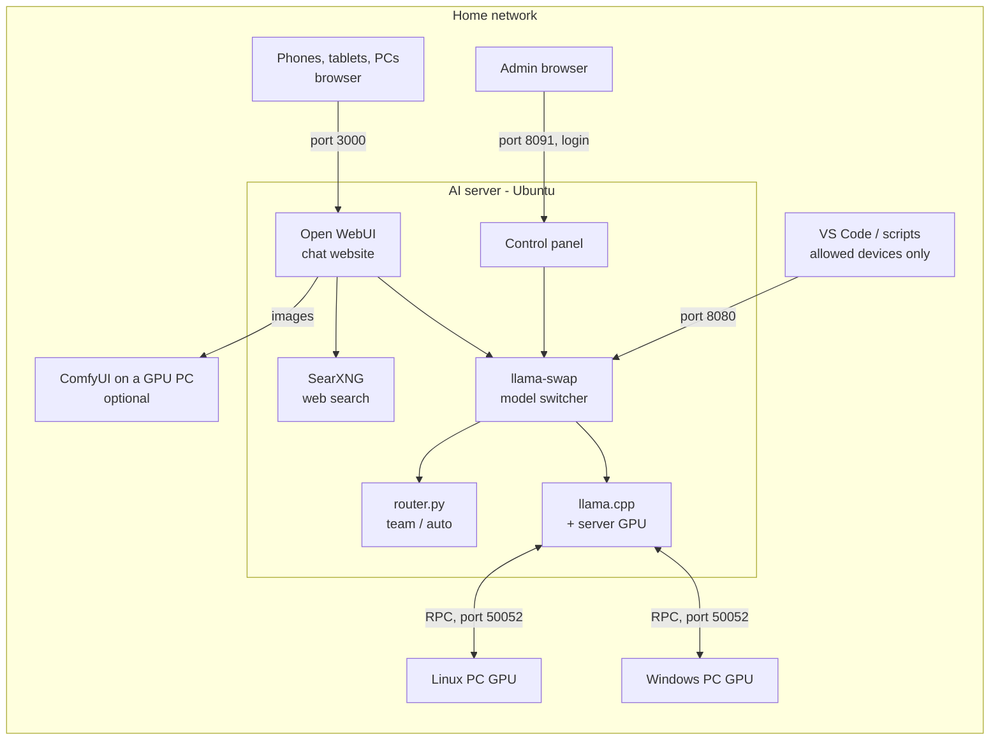

# Home AI Cluster

My home AI setup, cleaned up so other people can install it on their own network.

I have a small Ubuntu server with a 6 GB GTX 1660 Super and a gaming PC with an 11 GB RTX 2080 Ti. Neither card can run a 20B model on its own, but together they can. So this project splits one model across the GPUs of several PCs over the home network (llama.cpp RPC), and puts a normal chat website in front of it so my family can use it from their phones and laptops.

Everything runs on your own hardware: no cloud, no subscription, and the chats stay at home.

> **Status: beta.** It runs on my own server. A clean install on a fresh machine, AMD/Intel GPUs and RAID creation on real drives are not tested yet. If something breaks on your hardware, please open an issue.

## What it does

- **Family chat:** [Open WebUI](https://github.com/open-webui/open-webui) on port 3000, one account per person, works on phones.
- **GPU pooling:** big models are split across the server's GPU and the GPUs of other PCs ([llama.cpp](https://github.com/ggml-org/llama.cpp) RPC). Adding a PC is one `.bat` file on Windows or one command on Linux.
- **GPU control:** each GPU can be set to Use, Standby (only big models) or Off, for example while someone is gaming on that PC.
- **Models on demand:** [llama-swap](https://github.com/mostlygeek/llama-swap) loads a model when someone asks for it and unloads it later. Two extra models: `auto` picks a model for each message, `team` lets two models answer and a third combine them.
- **Control panel (port 8091):** add models from Hugging Face, live server and drive health, drives and RAID for storage, adding PCs, Telegram alerts.
- **Extras:** private web search with [SearXNG](https://github.com/searxng/searxng), optional image generation with [ComfyUI](https://github.com/comfyanonymous/ComfyUI), and an OpenAI/Anthropic-compatible API for VS Code and scripts.
- **Backups and alerts:** nightly backup of chats and settings, and a Telegram message if a disk, a RAID or a service has a problem.

## How it works



* The **server** stores the models and runs everything. The model is split layer by layer across all allowed GPUs.
* **GPU PCs** run a tiny worker (`rpc-server`) that only lends their GPU. Their own files are never touched, and only the server may connect to them.
* Models start when someone sends a message and stop after a while of no use, so GPU PCs are free for other work most of the time.

## Requirements

**AI server**
* Ubuntu Server **24.04 LTS or newer** (64-bit x86). A spare PC is fine.
* 16 GB RAM or more recommended (8 GB works with small models only).
* A GPU is recommended but not required. NVIDIA works best; AMD and Intel use Vulkan.
* About 30 GB of free disk for the starter models (an SSD makes loading faster). Extra drives are optional and can be used on their own or as a RAID.
* A wired network connection. 1 Gbit works; 2.5 Gbit or faster makes pooling between PCs quicker.

**GPU PCs (optional, any number)**
* Windows 10/11 or Linux, on the same home network, preferably wired.
* NVIDIA (latest driver), AMD or Intel GPU, ideally 6 GB+ of GPU memory.

## Quick start

On the **Ubuntu server** (via SSH or its own screen):

```bash
git clone https://github.com/shafakat12/home-ai-cluster.git
cd home-ai-cluster
cp config.example.env config.env      # optional: review the settings
sudo bash install.sh
```

* The installer asks **where to store the models** if the server has more than one drive: the system disk, a folder, a whole drive, or a RAID. See [Storage](docs/storage.md). Change it later in the control panel (**Storage** tab) or with `sudo ai-storage`.
* If the server has an NVIDIA GPU without a driver, the installer installs one and asks you to **reboot**. Run `sudo bash install.sh` again afterwards; it continues where it stopped.
* The starter models (3–24 GB, chosen to fit your GPU) download in the background. Follow along with `tail -f /opt/ai/logs/model-download.log`.
* At the end the installer prints your addresses and a **setup code** for the control panel.

Then:

1. Open **`http://SERVER-IP:3000`** and create the first account. It becomes the chat admin.
2. Open **`http://SERVER-IP:8091`** and create the control-panel admin password with the setup code.
3. *(Optional)* Add GPU PCs: on a Windows PC open `http://SERVER-IP:8090/add-this-pc.bat`, save it, double-click it and click **Yes**. On Linux run `curl -fsSL http://SERVER-IP:8090/add-worker-linux.sh | bash`.
4. *(Optional)* Add family members in Open WebUI: **Admin Panel → Users → ➕**. Then make the models public for them: **Admin Panel → Settings → Models → ✏️ → Access → Public**.

> **Tip:** reserve the server's IP address in your router (DHCP reservation or static lease). If the address changes, the GPU PCs and bookmarks stop finding it.

## Using it

| What | Where |
|---|---|
| Chat, pictures, web search, documents | `http://SERVER-IP:3000` |
| Admin: models, GPUs, health, add a PC, settings | `http://SERVER-IP:8091` |
| OpenAI-compatible API (allowed devices) | `http://SERVER-IP:8080/v1` (any API key) |
| Anthropic-compatible API (Claude Code) | `http://SERVER-IP:8080` |
| Worker installers | `http://SERVER-IP:8090` |

**Starter models** (`MODEL_PRESET` in `config.env`):

| Preset | Models | Download | Good for |
|---|---|---|---|
| `small` | Qwen3.5 4B (vision) | ~3 GB | any 4 GB+ GPU, fast everyday chat |
| `standard` | + gpt-oss 20B (pooled over all GPUs) | ~16 GB | coding, reasoning, agents |
| `full` | + Gemma 4 12B (vision) on the GPU PCs | ~24 GB | best quality; needs a second GPU PC |

`auto` (the default) chooses `standard` for servers with a 4 GB+ NVIDIA GPU and 16 GB RAM, otherwise `small`. Add any other GGUF model later in the control panel.

**Measured speeds** on my setup: GTX 1660 Super 6 GB server + RTX 2080 Ti 11 GB Windows PC, 2.5 GbE, llama.cpp b12189.
Each test asks for a 400-token answer, after the model has loaded (second run, Nov 2026).

| Model | Where it runs | Answer speed |
|---|---|---|
| `qwen3.5-4b` | server GPU | 63 tokens/s |
| `gemma-4-12b` (vision) | GPU PC | 42 tokens/s |
| `gpt-oss-20b` | split over both GPUs | 57–71 tokens/s (three runs) |
| `auto` | picks one model per message | the speed of the model it picks (42 tokens/s in the test) |
| `team` | two models answer, a third combines | about 2.5 minutes for a full 400-token answer |

Your speed depends on your GPUs and network. Measure it on the server (the second number is the real speed):

```bash
for i in 1 2; do curl -s http://127.0.0.1:8080/v1/chat/completions -H 'Content-Type: application/json' -d '{"model":"gpt-oss-20b","messages":[{"role":"user","content":"Write about 300 words about rivers."}],"max_tokens":400}' | jq '.timings.predicted_per_second'; done
```

## Known issues and what's next

- Only tested on my own hardware (GTX 1660 Super server + RTX 2080 Ti Windows PC, wired 2.5 GbE). AMD and Intel GPUs (Vulkan) should work but I haven't tried them.
- A full install on a fresh Ubuntu machine hasn't been tested end to end yet.
- Creating a RAID has only been tested as a dry run, not on real drives.
- `team` is slow (about 2.5 minutes per answer) because three models run one after another.
- Pooling needs a wired network. Over Wi-Fi it gets much slower.

## Documentation

* [How it works](docs/how-it-works.md): the parts, the ports, where files live
* [Adding GPU PCs](docs/adding-gpu-pcs.md): Windows and Linux, Use / Standby / Off, removing a PC
* [Storage](docs/storage.md): which drive or folder, RAID 0/1/5/10, replacing a failed drive
* [Models](docs/models.md): presets, adding models, solo / pool / remote, team & auto
* [Image generation](docs/image-generation.md): ComfyUI on a GPU PC, connecting Open WebUI
* [Family & other devices](docs/family-and-devices.md): accounts, model access, phones, VS Code
* [Security](docs/security.md): what is exposed, firewall, passwords, what not to do
* [Troubleshooting](docs/troubleshooting.md): problems I ran into and how to fix them

## Settings (`config.env`)

| Setting | Default | Meaning |
|---|---|---|
| `SERVER_IP` | detected | the server's address |
| `LAN_CIDR` | detected | your home network, e.g. `192.168.1.0/24` (only it may connect) |
| `ADMIN_PC_IP` | empty | your main PC: may use the API directly and create the panel password without the code |
| `MODEL_PRESET` | `auto` | `auto`, `small`, `standard`, `full`, `none` |
| `STORAGE` | empty (= ask) | where models go: `folder:/path`, `drive:/dev/sdb`, `raid1:/dev/sdb,/dev/sdc` (raid0/1/5/10). See [Storage](docs/storage.md) |
| `STORAGE_ERASE_OK` | `no` | `yes` = erase drives without typing ERASE (unattended installs only) |
| `STORAGE_BACKUPS` | `auto` | also keep the nightly backups on the new drive / RAID |
| `INSTALL_OPEN_WEBUI` / `INSTALL_WEB_SEARCH` / `INSTALL_CONTROL_PANEL` / `INSTALL_HEALTH` | `yes` | turn parts on/off |
| `INSTALL_NVIDIA_DRIVER` | `yes` | install the recommended NVIDIA driver if missing |

Run `sudo bash install.sh` again after changing settings. It is safe to re-run, and it keeps models you added. It never erases a drive a second time. Storage changes after the install: control panel **Storage** tab or `sudo ai-storage`.

## Updating and removing

```bash
cd home-ai-cluster && git pull && sudo bash install.sh   # update the scripts and services
sudo bash update-open-webui.sh                           # update the chat website (downloads while it keeps running)
sudo ai-storage                                          # move the models to another drive / folder / RAID
sudo bash uninstall.sh                                   # remove the services (keeps models + settings)
sudo bash uninstall.sh --purge                           # remove everything, including chats
```

## Repository layout

```
install.sh                  installer (run on the server with sudo)
config.example.env          settings - copy to config.env
server/steps/               the install steps, in order (10-base, 15-storage ... 90-finish)
server/files/               programs installed to /opt/ai (llama-run, router, control panel, ai-storage, ...)
worker/windows, worker/linux  GPU-PC installers (served by the server on port 8090)
image-generation/           ComfyUI installer for a Windows NVIDIA PC + Open WebUI workflow
clients/windows/            VS Code / Claude Code setup for a Windows PC
docs/                       documentation
tools/publish-to-github.ps1 publish your copy to GitHub (also used by Claude Code, see CLAUDE.md)
CLAUDE.md                   notes for AI coding assistants working on this repository
```

## Built with

[llama.cpp](https://github.com/ggml-org/llama.cpp) · [llama-swap](https://github.com/mostlygeek/llama-swap) · [Open WebUI](https://github.com/open-webui/open-webui) · [SearXNG](https://github.com/searxng/searxng) · [ComfyUI](https://github.com/comfyanonymous/ComfyUI) · [smartmontools](https://www.smartmontools.org/) · models from [Hugging Face](https://huggingface.co) (Qwen, gpt-oss, Gemma, Z-Image), each under its own license.

## License

MIT. See [LICENSE](LICENSE). This covers the scripts in this repository only.

The installer downloads other software, and each keeps its own license: llama.cpp (MIT), llama-swap (MIT), SearXNG (AGPL-3.0), ComfyUI (GPL-3.0), and Open WebUI, whose [Open WebUI License](https://github.com/open-webui/open-webui/blob/main/LICENSE) is BSD-3 plus a branding clause: keep the "Open WebUI" name and logo visible if more than 50 people use your installation. The models also have their own licenses (Apache-2.0, Gemma terms, ...); check them on each model's Hugging Face page.

*This project is not affiliated with any of the projects or model makers above.*
