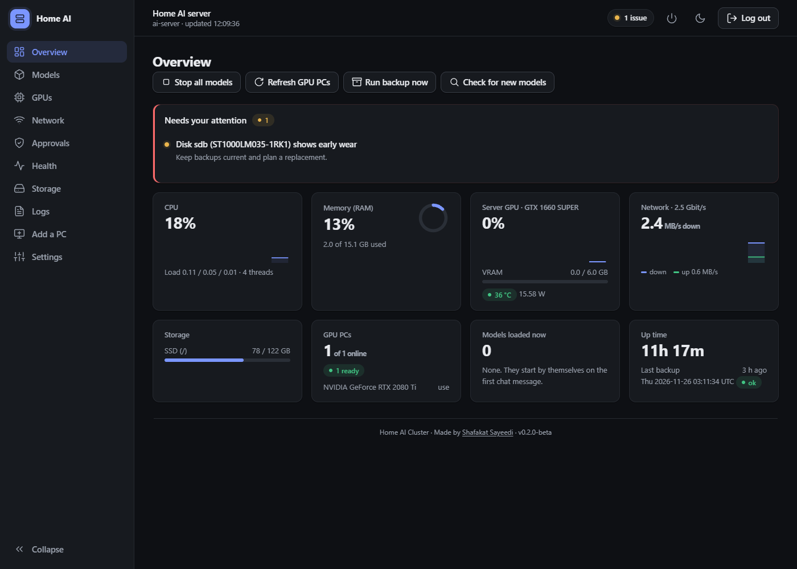
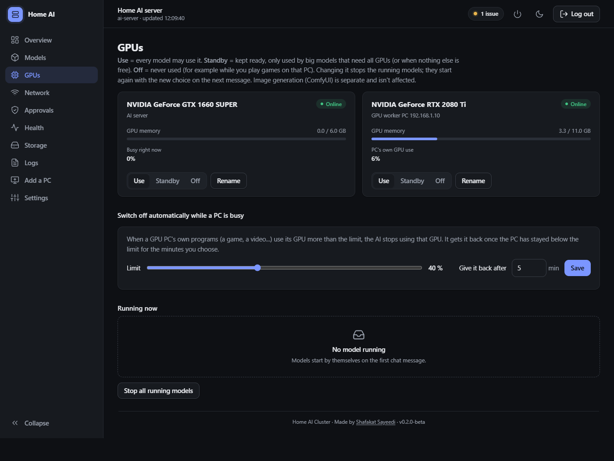
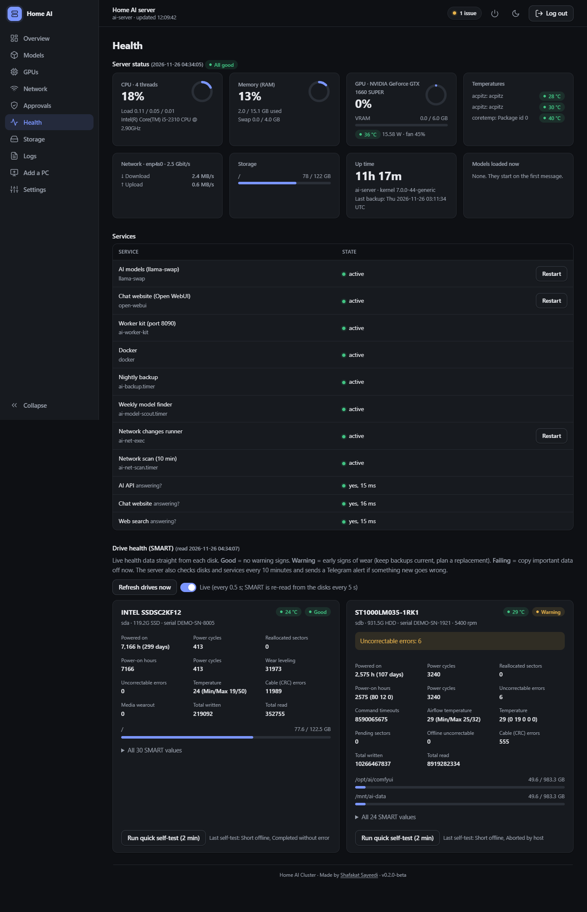
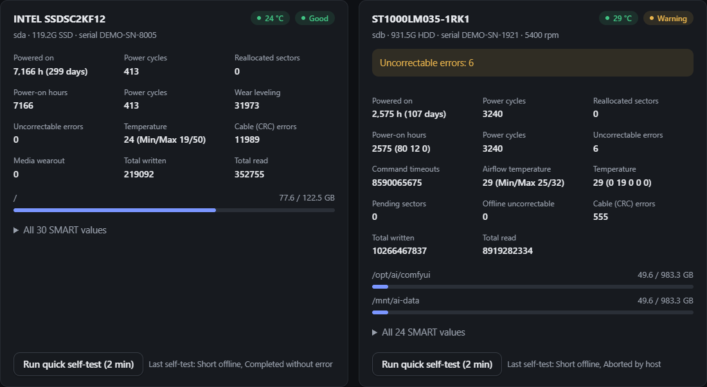
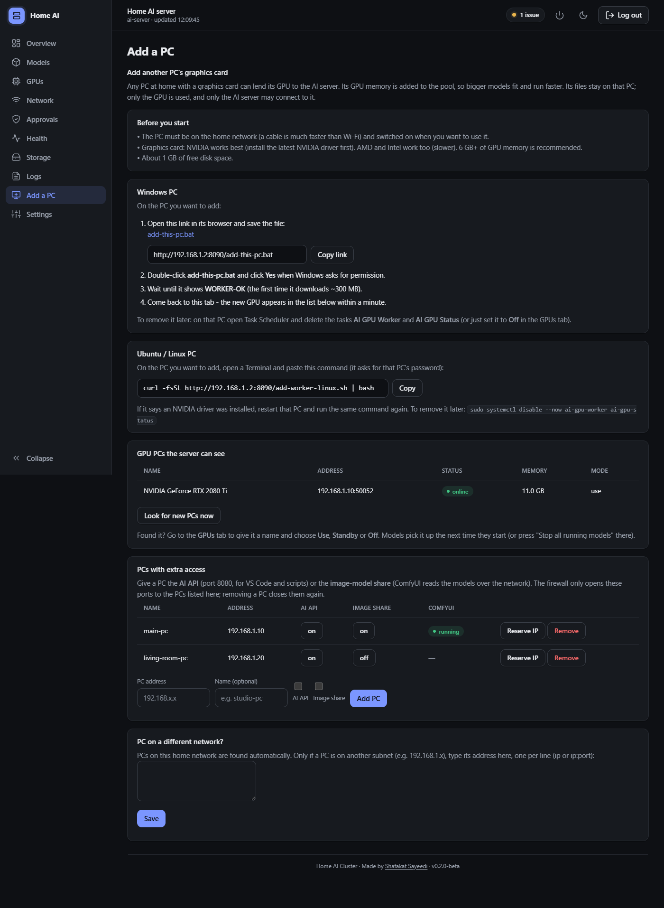
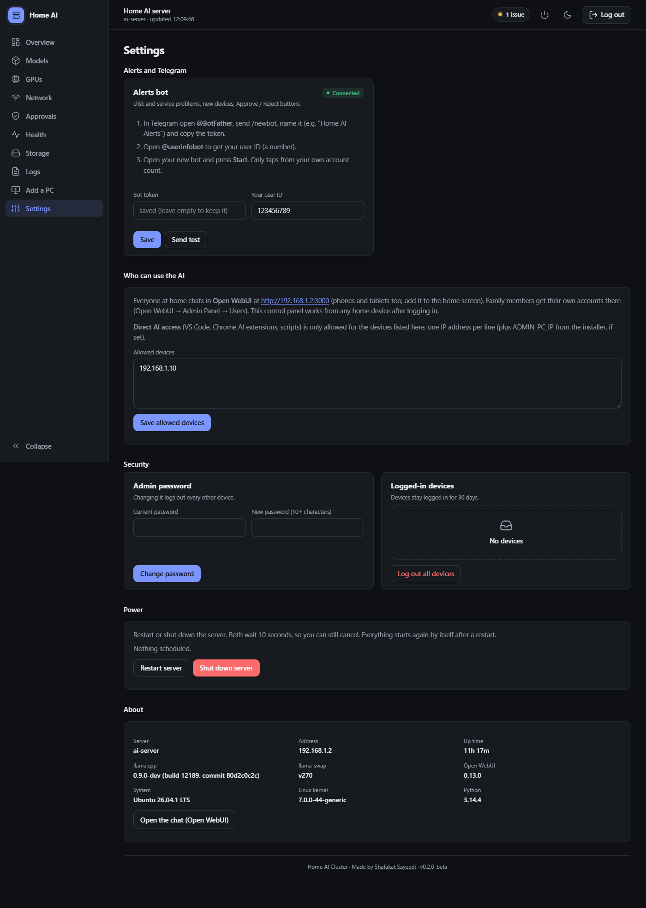

# The control panel, tab by tab

The control panel is at `http://SERVER-IP:8091`. It's the admin side of the server: everything that isn't chatting. Chatting happens in Open WebUI on port 3000.

The first time you open it, you create the admin password with the setup code the installer printed (also in `/opt/ai/secrets/setup-code` on the server). After that you log in with that password, from any device at home.

On a computer the tabs are in a sidebar on the left, which you can collapse. On a phone the main tabs are in a bar at the bottom and the rest are under **More**. The sun/moon button at the top switches between light and dark, and the power button next to it restarts or shuts down the server (see [Power](#power)). The page updates itself twice a second, so you never need to reload it. When something needs you, a red *issues* count shows at the top. Press it to go to the Overview.

| Tab | What it's for |
|---|---|
| [Overview](#overview) | everything at a glance, and one list of what needs your attention |
| [Models](#models) | installed models (test, load, unload), downloads, suggestions, search Hugging Face |
| [GPUs](#gpus) | which graphics cards the AI may use, auto-off, what is running now |
| [Network](#network-and-approvals) | the devices on your home network (only with the optional network watch) |
| [Approvals](#network-and-approvals) | changes waiting for your OK (only with the network watch) |
| [Health](#health) | live server status, services with restart buttons, drive health |
| [Storage](#storage) | what uses space where, backups, moving models to another drive or a RAID |
| [Logs](#logs) | the latest lines from each part of the server |
| [Add a PC](#add-a-pc) | lend a PC's graphics card, or give a PC direct access to the AI API or image share |
| [Settings](#settings) | Telegram alerts, who may use the API, password and logins, AdGuard and router, restart or shut down the server, About |

## Overview

- **Needs your attention.** One list of everything that's wrong right now: a stopped service, a disk with warnings, a degraded RAID, a nearly full disk, an old backup, a new device, a change waiting for approval. When all is fine it says *Nothing needs your attention right now*.
- **Tiles** for CPU, memory, the server's GPU, storage, the GPU PCs, the models loaded now (with **Stop all**), up time and the last backup. The small graphs show the last few minutes.

## Models

What you'll see, from top to bottom:

- **Installed models.** One card per model, with its size, whether it runs on the server's GPU (*solo*) or on all GPUs (*pool*), whether it can see pictures, which disk it's on (SSD or HDD) and when it was last used.
  - **Test** sends a short question and shows the answer and the speed. If the model isn't loaded yet, the test loads it first, which can take a minute.
  - **Load now** loads it before anyone asks, so the first answer is quick. **Unload** frees its GPU memory.
  - **Rename** changes the name shown in Open WebUI (old chats keep the old name). **Remove** deletes the model file.
- **Downloads.** Each download shows its progress, speed, how many GB are done and the time left. **Pause** stops it and keeps what's already downloaded, **Continue** picks up where it stopped, and **Cancel** deletes the partial file. When it says *ready*, refresh Open WebUI and the model is in the list.
- **Suggested new models.** Once a week the server looks on Hugging Face for new models that fit your GPUs. Each one shows its size, where it would run and whether it can see pictures. Nothing downloads until you press **Add**. **Check now** runs the check straight away.
- **Search Hugging Face.** Type a name (for example `qwen3.5 9b` or `coder`) and press **Search**. Press **Choose size** on a result to see its files:
  - Smaller files are faster and a bit less smart. **Q4_K_M** is a good default.
  - The tag tells you if it fits: *fits: server GPU*, *fits: all GPUs*, *all GPUs + RAM (slow)* or *too big*.
  - **solo** runs on the server's GPU only. **pool** splits the model over all GPUs that are set to Use.
  - *Name in the menu* is the name people will see in Open WebUI.

The starter models from the installer stay on the system disk. Models you add later go to the storage drive or RAID, if you set one up (see [Storage](#storage)). Models don't use the GPUs until someone sends a message. They load then, and unload again after they've been idle for a while. More in [Models](models.md).

## GPUs

- **Your GPUs.** One card per graphics card: the server's own GPU and every GPU PC the server has found.
  - **Rename:** give it a friendlier name.
  - **Where:** the server, or the PC's IP address.
  - **Memory used:** how full that card's memory is.
  - **Status:**
    - *online*: ready to be used.
    - *in use by a model*: a model is running on it right now. A GPU PC can only serve one model at a time, so it's busy, not broken.
    - *online, slow to answer*: it's reachable but answering slowly (often Wi-Fi or a busy PC).
    - *offline*: the PC is off or can't be reached. An offline PC gets a **Forget** button (see below).
  - **Mode**, one of three:
    - **Use**: any model may use it.
    - **Standby**: kept ready, only used by big models that need all the GPUs.
    - **Off**: never used.
    - Changing a mode stops the running models. They start again with the new setting on the next message.
- **Switch off automatically while a PC is busy (auto-off).** When a GPU PC's own programs (a game, a video, editing...) use its GPU more than the percentage you set (40% by default), the server switches that GPU to Off and stops any model running on it, so the PC is all yours. Once the PC has been below that for the number of minutes you set (5 by default), it goes back to what it was. Under each GPU PC you'll see:
  - *PC's own use: 12% (game.exe)*: the PC's own GPU use. The AI's use isn't counted.
  - *off automatically: the PC is using it*: auto-off has switched it off for now.
  - *no GPU-use report from this PC*: auto-off can't work for this PC yet. Run the installer on it again (Add a PC tab).
  - If you change a GPU's mode yourself, your choice wins: auto-off won't switch back on a GPU that you turned Off.
  - Setting 0% turns auto-off off.
- **Forget.** Removes an offline GPU from the list, including its name and settings. Use it for a PC you don't have anymore, or one that got a new IP address and now shows up twice. See [IP addresses](ip-addresses.md).
- **Running now.** The models loaded at the moment. **Stop all running models** frees all GPU memory straight away.

Image generation (ComfyUI) is separate and isn't affected by any of this. More in [Adding GPU PCs](adding-gpu-pcs.md).

## Network and approvals

These two tabs only show up when the optional network watch is installed (`INSTALL_NETWORK_WATCH=yes`). Everything about it is in [Network watch](network.md).

- **Network.** Every device on your home network with its IP address, maker, MAC address and when it was last seen. New devices have a *new* tag. Tick **Mine**, type a name and press **Save** for the devices you know. Red tags are risky open services (Telnet, for example). **Block...** and **Unblock...** only *ask* for the change. **Scan now** scans straight away.
- **Approvals.** The changes that were asked for, with what and why. **Approve** carries one out, **Reject** throws it away. If Telegram is set up, the same buttons come to your phone. Earlier requests stay in the list with how they ended (*done*, *failed* or *rejected*).

## Health

- **Server status.** Live cards for CPU, memory, each GPU (use, memory, temperature, power), temperatures, network speed, storage (including RAID state), uptime and last backup.
- **Services.** Whether each part (chat website, model switcher, web search, control panel, worker kit, health checks, network watch...) is running and answering. The model switcher (llama-swap), the chat website (Open WebUI) and the network watch's change service have a **Restart** button. Restarting the model switcher stops the running models.
- **Drive health (SMART).** What each disk reports about itself:
  - **Good**: no warning signs.
  - **Warning**: early signs of wear. Keep your backups current and plan a replacement.
  - **Failing**: copy important data off now.
  - **Run quick self-test** asks the disk to check itself (about 2 minutes). Open *All SMART values* for the full list.

The server also checks disks and services every 10 minutes by itself and sends a Telegram message if something new goes wrong (Settings tab).

## Storage

- **Disks.** How full each disk is, and whether it's an SSD or an HDD.
- **What is where.** How much space the starter models and the downloaded models use, and on which disk.
- **Biggest files.** Files over 200 MB on the server. **Measure again** updates the sizes (it takes a moment on big disks).
- **Backups.** The nightly backups of the last 7 days. **Run backup now** makes one straight away.
- **Where downloaded models and backups are kept.** The current place.
- **Use another drive or a RAID: this erases the drives you tick.** Tick the drive or drives to use. You can't tick the system disk, a drive that's in use or a drive that's already part of a RAID. Then choose how:

  | Option | Drives | If a drive dies |
  |---|---|---|
  | One drive (no RAID) | 1 | everything on it is lost |
  | RAID 1, mirror | 2+ | keeps working |
  | RAID 5 | 3+ | keeps working, more space than RAID 1 |
  | RAID 10 | 4+ | keeps working, fast |
  | RAID 0 | 2+ | everything is lost (fine for models, not for backups) |

  Press **Show what will happen** first. It changes nothing. To really do it, type `ERASE`, enter your admin password and press **Erase and set up**. Models already downloaded are moved over automatically. The starter models stay on the system disk.
- **Or use a folder: this erases nothing.** Type a folder on a drive that's already set up, then press **Move the models there** or **Move the backups there**. `/opt/ai/models` goes back to the system disk.
- **Progress.** The log of the running or last storage job.

RAID is not a backup. More in [Storage](storage.md).

## Logs

Pick a part of the server (control panel, AI models, model downloads, starter model download, health check, backups, network watch) to see its latest lines. They update by themselves. **Pause** stops the updates so you can read or copy.

## Add a PC

Lend another PC's graphics card to the server, and give any PC extra access.

- **Windows:** open the `add-this-pc.bat` link on that PC, save it, double-click it and click **Yes**. Wait for **WORKER-OK**. It installs two small background tasks: the GPU worker and the GPU-use report for auto-off.
- **Linux:** copy the command shown and paste it into a terminal on that PC.
- **GPU PCs the server can see.** New PCs show up here within a minute. **Look for new PCs now** checks again. Then go to the GPUs tab to name the new GPU and choose Use, Standby or Off.
- **PC on a different network?** Only needed if a PC is on another subnet: type its address here.

**PCs with extra access.** A small table of PCs you've given direct access to, each with two switches the server turns into firewall rules for you:

- **AI API** — this PC may use the models API on port 8080 directly (VS Code, Claude Code, scripts, browser AI extensions).
- **Image share** — this PC may mount the image folder (NFS), used when ComfyUI runs on a GPU PC.
- **Reserve IP** — asks your router to always give this PC the same address (needs a supported router set up under Settings → Router; it backs up the router's settings first and asks you to confirm).
- **ComfyUI** — shows whether image generation is answering on that PC.
- **Remove** takes the PC out of the list and removes its firewall rules.

Add a PC by typing its address and ticking what it may use. Nothing here opens a port to the whole network — only to the one address you add.

More in [Adding GPU PCs](adding-gpu-pcs.md) and [Add another PC later](adding-gpu-pcs.md#add-another-pc-later).

## Settings

- **Alerts and Telegram (optional).** Get a message on your phone when a disk shows problems, a service stops, a GPU is switched off automatically, better models are found or (with the network watch) a new device joins. With the network watch, approval requests come with **Approve** / **Reject** buttons. The steps to create the bot are on the page. **Send test** sends a test message.
- **Who can use the AI.** The chat address for the family, and the list of devices allowed to use the API directly (VS Code, scripts, browser AI extensions). One IP address per line. (The **Add a PC** tab does the same per PC with a switch.)
- **Security.** Change the admin password, see which devices are logged in, and log out one or all of them.
- **Home network helpers** (with the network watch). Connect AdGuard Home, choose your router type and enter its login, **Test connection** (read-only) and **Auto-detect**. The server's public SSH key for routers is shown here. A saved password or key is never shown again. See [Network watch](network.md).
- **Power.** See [below](#power).
- **About.** The server's name and address, its up time, and the versions of llama.cpp, llama-swap, Open WebUI and the other parts.

### Power

**Restart server** and **Shut down server** are in Settings, and the power button at the top of every page opens the same choice.

- Both wait **10 seconds**, so you can change your mind. While one is waiting, every tab shows a red banner (*Restarting in 9…*) with a big **Cancel** button.
- Before it starts, the panel tells you what will be interrupted: model downloads in progress (press **Continue** afterwards), models that are loaded (answers being written are cut off) and a backup that is running.
- **Restart** needs one click. Everything (the chat, the AI, the control panel) starts again by itself after a few minutes.
- **Shut down** asks you to type the server's name first. The panel can't switch the server back on: you'll need its power button.
- Each restart, shutdown or cancel is written to the panel's log (Logs tab, *Control panel*) with the time and the device it came from.

## Where else things happen

| What | Where |
|---|---|
| Chatting, accounts for the family, which models each person sees | Open WebUI, `http://SERVER-IP:3000` |
| The installers that GPU PCs download | `http://SERVER-IP:8090` (worker kit) |
| VS Code, scripts, Claude Code | the API on `http://SERVER-IP:8080` |
| Changing storage from a terminal | `sudo ai-storage` on the server |

---

Home AI Cluster · Made by [Shafakat Sayeedi](https://shafakat12.github.io/shafakat/)
