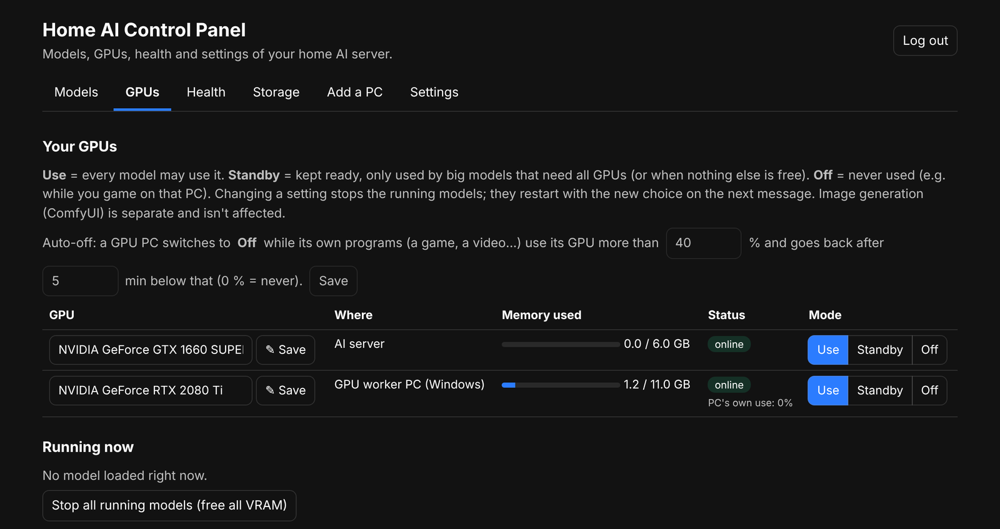
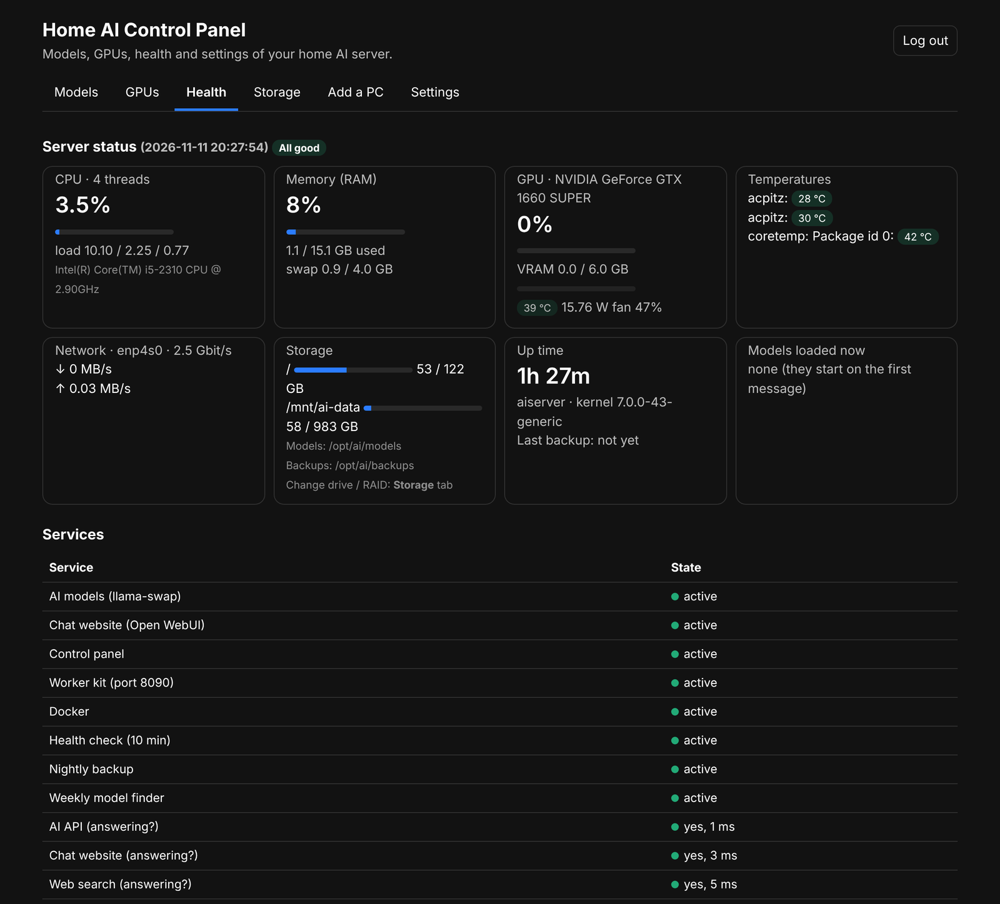
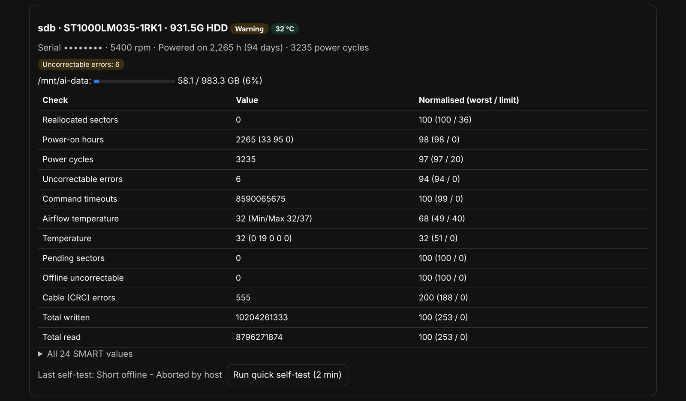

# The control panel, tab by tab

The control panel is at `http://SERVER-IP:8091`. It's the admin side of the server: everything that isn't chatting. Chatting happens in Open WebUI on port 3000.

The first time you open it, you create the admin password with the setup code the installer printed (also in `/opt/ai/secrets/setup-code` on the server). After that you log in with that password, from any device at home.

There are six tabs:

| Tab | What it's for |
|---|---|
| [Models](#models) | find, add, rename and remove AI models |
| [GPUs](#gpus) | which graphics cards the AI may use, auto-off, what is running now |
| [Health](#health) | live CPU, memory, GPU, temperatures, network, services and drive health |
| [Storage](#storage) | which drive, folder or RAID the models and backups live on |
| [Add a PC](#add-a-pc) | lend another PC's graphics card to the server |
| [Settings](#settings) | Telegram alerts, which devices may use the API, password and logins |

## Models

What you'll see, from top to bottom:

- **Suggested new models.** Once a week the server looks on Hugging Face for new models that fit your GPUs. Each one shows its size, where it would run and whether it can see pictures (vision). Nothing downloads until you press **Add**. **Check now** runs the check straight away.
- **Search Hugging Face.** Type a name (for example `qwen3.5 9b` or `coder`) and press **Search**. Press **Choose size** on a result to see its files:
  - Smaller files are faster and a bit less smart. **Q4_K_M** is a good default.
  - The tag tells you if it fits: *fits: server GPU*, *fits: all GPUs*, *all GPUs + RAM (slow)* or *too big*.
  - **solo** runs on the server's GPU only; **pool** splits the model over all GPUs that are set to Use.
  - *Name in the menu* is the name people will see in Open WebUI.
- **Downloads.** A progress bar for each download. When it says *ready*, refresh Open WebUI and the model is in the list.
- **Installed models.** **Rename** changes the name shown in Open WebUI (old chats keep the old name). **Remove** deletes the model file.

Models don't use the GPUs until someone sends a message. They load then, and unload again after they've been idle for a while. More in [Models](models.md).

## GPUs

- **Your GPUs.** One row per graphics card: the server's own GPU and every GPU PC the server has found.
  - **Name:** type a friendlier name and press **Save**.
  - **Where:** the server, or the PC's IP address.
  - **Memory used:** how full that card's memory is.
  - **Status:**
    - *online*: ready to be used.
    - *in use by a model*: a model is running on it right now. A GPU PC can only serve one model at a time, so it's busy, not broken.
    - *online, slow to answer*: it's reachable but answering slowly (often Wi-Fi or a busy PC).
    - *offline*: the PC is off or can't be reached. For an offline PC there's a **Forget** button (see below).
  - **Mode**, one of three:
    - **Use**: any model may use it.
    - **Standby**: kept ready, only used by big models that need all the GPUs.
    - **Off**: never used.
    - Changing a mode stops the running models. They start again with the new setting on the next message.
- **Auto-off.** When a GPU PC's own programs (a game, a video, editing...) use its GPU more than the percentage you set (40% by default), the server switches that GPU to Off and stops any model running on it, so the PC is all yours. Once the PC has been below that for the number of minutes you set (5 by default), it goes back to what it was. Under each GPU PC you'll see:
  - *PC's own use: 12% (game.exe)*: the PC's own GPU use. The AI's use isn't counted.
  - *off automatically: the PC is using it*: auto-off has switched it off for now.
  - *no GPU-use report from this PC*: auto-off can't work for this PC yet. Run the installer on it again (Add a PC tab).
  - If you change a GPU's mode yourself, your choice wins: auto-off won't switch back on a GPU that you turned Off.
  - Setting 0% turns auto-off off.
- **Forget.** Removes an offline GPU from the list, including its name and settings. Use it for a PC you don't have anymore, or one that got a new IP address and now shows up twice. See [IP addresses](ip-addresses.md).
- **Running now.** The models loaded at the moment. **Stop all running models** frees all GPU memory straight away.

Image generation (ComfyUI) is separate and isn't affected by any of this. More in [Adding GPU PCs](adding-gpu-pcs.md).

## Health

- **Server status.** Live cards for CPU, memory, each GPU (use, memory, temperature, power), temperatures, network speed, storage (including RAID state), uptime, last backup and the models loaded right now. A red tag at the top lists anything that's wrong; otherwise it says *All good*.
- **Services.** Whether each part (chat website, model switcher, web search, control panel, worker kit, health checks...) is running and answering.
- **Drive health (SMART).** What each disk reports about itself:
  - **Good**: no warning signs.
  - **Warning**: early signs of wear. Keep your backups current and plan a replacement.
  - **Failing**: copy important data off now.
  - **Run quick self-test** asks the disk to check itself (about 2 minutes). Open *All SMART values* for the full list.

The server also checks disks and services every 10 minutes by itself and sends a Telegram message if something new goes wrong (Settings tab).

## Storage

Where the models and the nightly backups are kept. The top line shows the current place.

- **Drives.** Tick the drive or drives to use. You can't tick the system disk, a drive that's in use or a drive that's already part of a RAID.
- **Use the ticked drive(s): this erases them.** Choose how:

  | Option | Drives | If a drive dies |
  |---|---|---|
  | One drive (no RAID) | 1 | everything on it is lost |
  | RAID 1, mirror | 2+ | keeps working |
  | RAID 5 | 3+ | keeps working, more space than RAID 1 |
  | RAID 10 | 4+ | keeps working, fast |
  | RAID 0 | 2+ | everything is lost (fine for models, not for backups) |

  Press **Show what will happen** first. It changes nothing. To really do it, type `ERASE`, enter your admin password and press **Erase and set up**. Models already downloaded are moved over automatically.
- **Or use a folder: this erases nothing.** Type a folder on a drive that's already set up, then press **Move the models there** or **Move the backups there**. `/opt/ai/models` goes back to the system disk.
- **Progress.** The log of the running or last storage job.

RAID is not a backup. More in [Storage](storage.md).

## Add a PC

How to lend another PC's graphics card to the server.

- **Windows:** open the `add-this-pc.bat` link on that PC, save it, double-click it and click **Yes**. Wait for **WORKER-OK**. It installs two small background tasks: the GPU worker and the GPU-use report for auto-off.
- **Linux:** copy the command shown and paste it into a terminal on that PC.
- **GPU PCs the server can see.** New PCs show up here within a minute. **Look for new PCs now** checks again. Then go to the GPUs tab to name the new GPU and choose Use, Standby or Off.
- **PC on a different network?** Only needed if a PC is on another subnet: type its address here.

The page also shows how to remove a PC again. More in [Adding GPU PCs](adding-gpu-pcs.md).

## Settings

- **Telegram alerts (optional).** Get a message on your phone when a disk shows problems, a service stops, a GPU is switched off automatically or better models are found. The steps to create the bot are on the page.
- **Use the AI from other devices.** The chat address for the family, and the list of devices allowed to use the API directly (VS Code, scripts, browser AI extensions). One IP address per line.
- **Admin password and logins.** Change the panel password, see which devices are logged in, and log them all out.
- **Output.** The result of the last action you did anywhere in the panel.

## Where else things happen

| What | Where |
|---|---|
| Chatting, accounts for the family, which models each person sees | Open WebUI, `http://SERVER-IP:3000` |
| The installers that GPU PCs download | `http://SERVER-IP:8090` (worker kit) |
| VS Code, scripts, Claude Code | the API on `http://SERVER-IP:8080` |
| Changing storage from a terminal | `sudo ai-storage` on the server |
